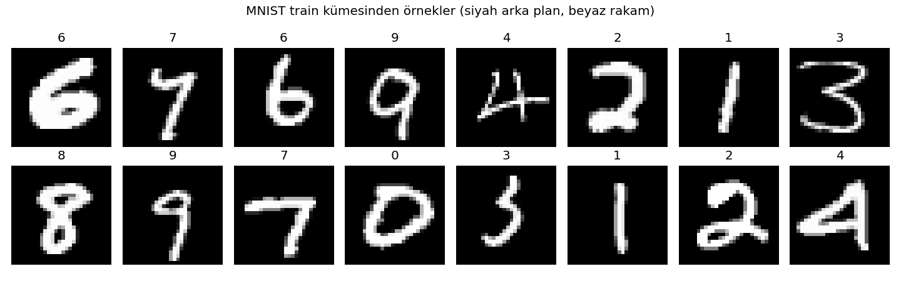
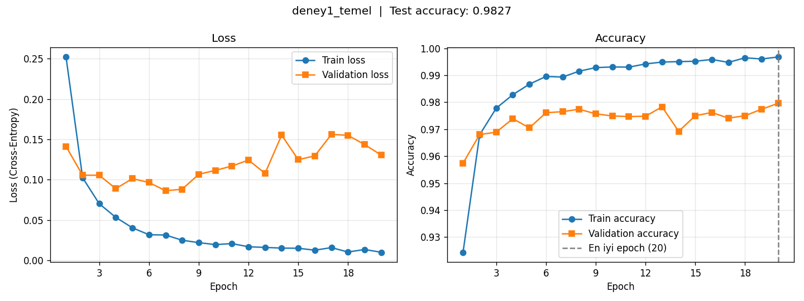
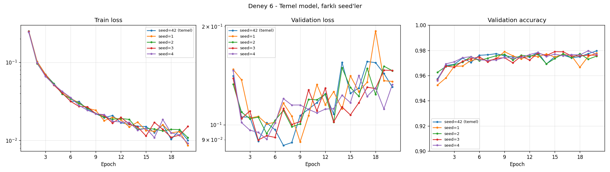
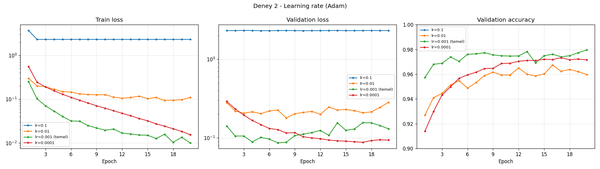
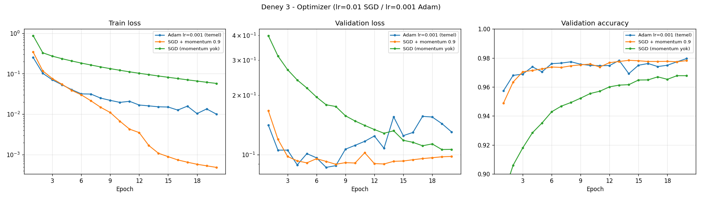
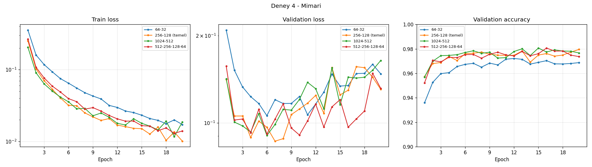
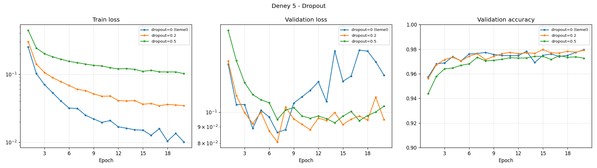
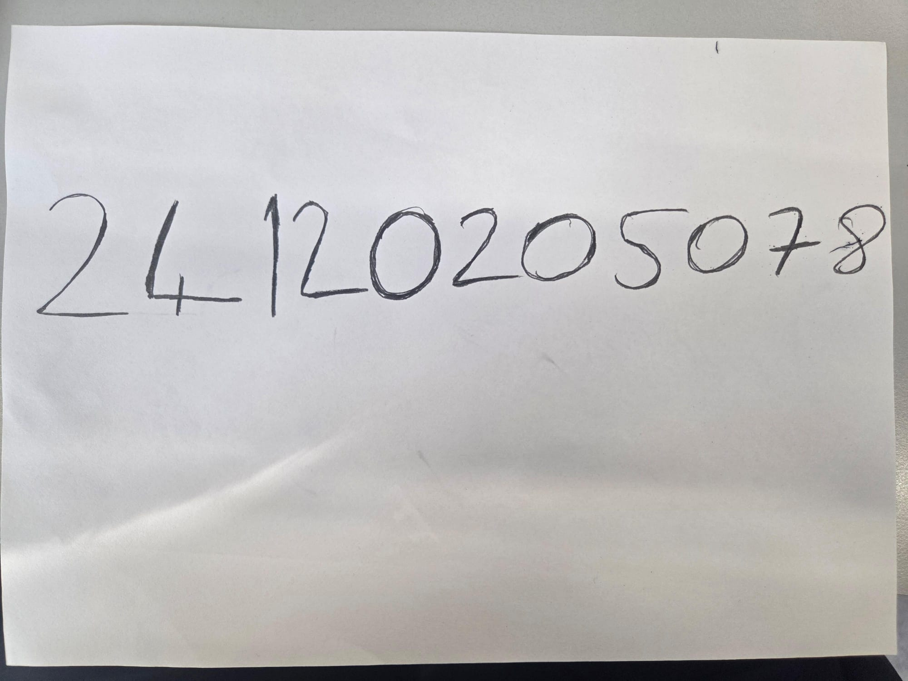
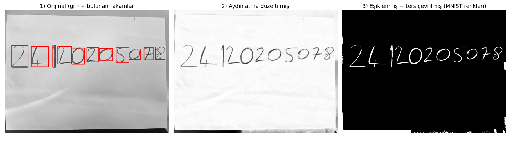
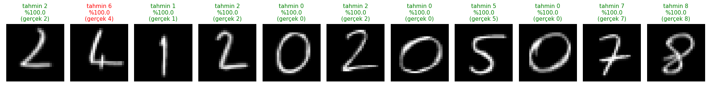

# MNIST ile MLP Tabanlı El Yazısı Rakam Tanıma

**Ders:** Derin Öğrenme  
**Öğrenci:** _[Ad Soyad]_ — 24120205078

Bu projede MNIST veri seti üzerinde **sıfırdan** eğitilen bir Multi-Layer Perceptron (MLP) ile el yazısı rakam tanıma yapılmıştır. Temel modelin ardından learning rate, optimizer, mimari ve dropout ayarları tek tek değiştirilerek etkileri karşılaştırılmış, son olarak model kendi el yazımla yazdığım okul numaram üzerinde test edilmiştir.

- Kütüphane: **PyTorch 2.6** (GPU: CUDA)
- CNN **kullanılmamıştır**; tüm modeller yalnızca `Linear` + `ReLU` (+ isteğe bağlı `Dropout`) katmanlarından oluşur.
- Hazır eğitilmiş model **kullanılmamıştır**; tüm ağırlıklar rastgele başlatılıp MNIST üzerinde eğitilmiştir.

---

## 1. Dosya yapısı

| Dosya / klasör | İçerik |
|---|---|
| [`data.py`](data.py) | MNIST indirme, train/validation/test ayrımı, normalizasyon |
| [`model.py`](model.py) | Katman sayısı/genişliği ayarlanabilir MLP sınıfı |
| [`train.py`](train.py) | Eğitim döngüsü, değerlendirme, grafik çizimi. Doğrudan çalıştırılınca **Deney 1**'i yapar |
| [`experiments.py`](experiments.py) | Deney 1–6'nın tamamını çalıştırır, karşılaştırma grafikleri ve özet tabloyu üretir |
| [`predict_own.py`](predict_own.py) | Kendi el yazısı fotoğrafını MNIST formatına çevirip modele verir |
| [`el_yazisi/`](el_yazisi/) | Okul numaramın el yazısı fotoğrafı ve modele verilen 28×28 işlenmiş rakamlar (`islenmis/`) |
| [`outputs/`](outputs/) | Tüm grafikler, her deneyin epoch bazlı sonuçları (`*_sonuclar.json`), özet tablo |
| `models/deney1_temel.pt` | Eğitilmiş temel model (el yazısı testi için) |

## 2. Kurulum ve çalıştırma

```bash
pip install -r requirements.txt

python data.py            # veri ayrımını kontrol eder, örnek görüntüleri kaydeder
python model.py           # model mimarisini ve parametre sayısını yazdırır
python train.py           # Deney 1 (temel model)   ~30 sn (GPU)
python experiments.py     # Deney 1-6, 15 eğitim     ~8 dk (GPU)
python predict_own.py el_yazisi/<fotograf>.jpg --label <okul_numarasi> --all-models
```

MNIST ilk çalıştırmada `mnist_data/` klasörüne otomatik indirilir. Kod CUDA yoksa CPU'da da çalışır (daha yavaş).
Tüm sonuçlar sabit seed (42) ile tekrarlanabilir: aynı deney iki kez çalıştırıldığında aynı doğruluk değerleri elde edilmiştir.

## 3. Veri seti ve train / validation / test ayrımı

| Küme | Kaynak | Örnek sayısı | Kullanım amacı |
|---|---|---|---|
| **Train** | MNIST resmi eğitim kümesi | 50.000 | Ağırlıkların güncellenmesi |
| **Validation** | MNIST resmi eğitim kümesi | 10.000 | Overfitting takibi, en iyi epoch'un ve hiperparametrelerin seçimi |
| **Test** | MNIST resmi test kümesi | 10.000 | Sadece eğitim bittikten sonra, **bir kez** final ölçüm |

- Resmi 60.000'lik eğitim kümesi sabit seed (`SEED = 42`) ile karıştırılıp 50.000 / 10.000 olarak bölünmüştür. Bölme her çalıştırmada ve her deneyde aynıdır.
- **Test verisi model geliştirme sürecinde hiç kullanılmamıştır.** En iyi epoch ve en iyi ayar seçimi validation accuracy'ye göre yapılır. Test accuracy, seçim yapıldıktan sonra yalnızca raporlama amacıyla hesaplanır.
- **Normalizasyon:** Pikseller önce 0–1 aralığına ölçeklenir, sonra `(x − mean) / std` uygulanır. `mean = 0.1307` ve `std = 0.3082` değerleri **yalnızca train kümesinden** hesaplanmıştır. Validation/test verisinden istatistik çıkarmak veri sızıntısı (data leakage) olurdu.



## 4. Model

Temel model (Deney 1):

```
Girdi 1×28×28 → Flatten (784) → Linear(784→256) → ReLU → Linear(256→128) → ReLU → Linear(128→10) → logits
```

| Katman | Hesap | Parametre |
|---|---|---|
| 784 → 256 | 784·256 + 256 | 200.960 |
| 256 → 128 | 256·128 + 128 | 32.896 |
| 128 → 10 | 128·10 + 10 | 1.290 |
| **Toplam** | | **235.146** |

- **ReLU** doğrusal olmayanlık sağlar. ReLU olmasaydı ardışık `Linear` katmanlar tek bir `Linear` katmana eşdeğer olurdu.
- **Loss:** `CrossEntropyLoss`. Softmax'ı kendi içinde uyguladığı için modelin son katmanında softmax yoktur.
- **Doğrulama kontrolü:** Eğitim öncesi validation loss **2.3040** ölçülmüştür. Bu değer rastgele tahmin yapan bir 10-sınıflı modelden beklenen `ln(10) = 2.3026` ile uyumludur. Model gerçekten sıfırdan başlamaktadır.
- **Model seçimi:** Her epoch sonunda validation accuracy ölçülür ve en yüksek olduğu epoch'un ağırlıkları saklanır (early stopping benzeri). Test bu ağırlıklarla yapılır.

## 5. Hiperparametreler

Tüm deneylerde **ortak** ayarlar:

| Hiperparametre | Değer |
|---|---|
| Epoch | 20 |
| Batch size | 64 (eğitim), 1000 (değerlendirme; sonucu etkilemez) |
| Loss | Cross-Entropy |
| Ağırlık başlatma | PyTorch varsayılanı (Kaiming-uniform) |
| Seed | 42 (Deney 6 hariç) |
| Veri artırma (augmentation) | Yok |
| Weight decay | Yok |

Her deneyde temel modele göre **sadece bir ayar** değiştirilmiştir:

| Deney | Değiştirilen ayar | Denenen değerler |
|---|---|---|
| 1 – Temel | — | 256-128, ReLU, Adam, lr = 0.001, dropout = 0 |
| 2 – Learning rate | Adam lr | 0.1 / 0.01 / **0.001** / 0.0001 |
| 3 – Optimizer | Optimizer | **Adam (lr 0.001)** / SGD + momentum 0.9 (lr 0.01) / SGD momentumsuz (lr 0.01) |
| 4 – Mimari | Gizli katmanlar | 64-32 / **256-128** / 1024-512 / 512-256-128-64 |
| 5 – Dropout | Dropout oranı | **0** / 0.2 / 0.5 |
| 6 – Seed | Rastgelelik | **42** / 1 / 2 / 3 / 4 |

(Kalın değerler = temel model.)

---

## 6. Deney 1 – Temel MLP modeli

| Metrik | Değer |
|---|---|
| Training loss (son epoch) | **0.0101** |
| Validation loss (son epoch) | **0.1305** |
| Training accuracy (son epoch) | **%99.68** |
| Validation accuracy (en iyi, epoch 20) | **%97.96** |
| **Test accuracy** | **%98.27** |
| Eğitim süresi (20 epoch, NVIDIA GPU) | **29.9 sn** |



**Yorum:**

- **Hızlı öğrenme:** Model ilk epoch sonunda validation'da %95.7'ye ulaşıyor. MNIST bir MLP için bile görece kolay bir problem.
- **Epoch 1'de train loss > val loss (0.25 > 0.14):** Train loss epoch boyunca biriken ortalamadır ve epoch'un başındaki henüz eğitilmemiş modeli de içerir. Val loss ise epoch sonundaki eğitilmiş modelle ölçülür. Bu bir hata değildir.
- **Overfitting:** Train loss 20 epoch boyunca sürekli düşüyor (0.25 → 0.01). Validation loss ise **7. epoch civarında minimuma (≈0.086) iniyor, sonra dalgalanarak yükseliyor (≈0.13–0.16)**. Train ile validation accuracy arasında yaklaşık %2'lik bir fark (99.7 – 97.8) kalıyor. Model 5–7. epoch'tan sonra genellenebilir örüntüler yerine train kümesine özgü ayrıntıları ezberlemeye başlıyor.
- **Val loss artarken val accuracy neden düşmüyor?** Accuracy yalnızca "doğru sınıf en yüksek skoru aldı mı?" sorusuna bakar. Cross-entropy ise modelin ne kadar emin olduğunu da cezalandırır. Model, yanlış sınıflandırdığı az sayıdaki örnekte giderek **aşırı emin (overconfident)** hale geldiği için loss yükselir, accuracy ise neredeyse sabit kalır.
- **Test ≈ validation:** Test accuracy (%98.27) validation'a (%97.96) çok yakın. Validation kümesi, modelin görmediği veri üzerindeki performansı iyi tahmin etmiş.

---

## 7. Karşılaştırma deneyleri

### Önce: "anlamlı fark" ne kadar? (Deney 6 – seed)

Temel model **hiçbir ayar değiştirilmeden**, yalnızca farklı seed'lerle (yani farklı rastgele başlangıç ağırlıkları ve farklı batch sırasıyla) 5 kez eğitilmiştir:

| Seed | 42 | 1 | 2 | 3 | 4 | **Ortalama ± std** |
|---|---|---|---|---|---|---|
| En iyi val acc | 0.9796 | 0.9790 | 0.9773 | 0.9790 | 0.9797 | **0.9789 ± 0.0010** |
| Test acc | 0.9827 | 0.9782 | 0.9797 | 0.9810 | 0.9796 | **0.9802 ± 0.0017** |



Sadece rastgelelik nedeniyle doğruluk **±%0.1–0.2** oynuyor. Dolayısıyla aşağıdaki deneylerde **%0.2'nin altındaki farklar anlamlı kabul edilmemiştir.**

### Özet tablo

Son epoch değerleri ve validation'a göre seçilen en iyi epoch:

| Deney | Gizli katmanlar | Optimizer | lr | Dropout | Parametre | Train loss | Val loss | Train acc | En iyi val acc (epoch) | Test acc | Süre (sn) |
|---|---|---|---|---|---|---|---|---|---|---|---|
| **deney1_temel** | 256-128 | adam | 0.001 | 0.0 | 235,146 | 0.0101 | 0.1305 | 0.9968 | 0.9796 (20) | 0.9827 | 29.9 |
| deney2_lr_0.1 | 256-128 | adam | 0.1 | 0.0 | 235,146 | 2.3105 | 2.3151 | 0.1045 | 0.1129 (3) | 0.1135 | 29.1 |
| deney2_lr_0.01 | 256-128 | adam | 0.01 | 0.0 | 235,146 | 0.1091 | 0.2825 | 0.9760 | 0.9674 (16) | 0.9688 | 29.0 |
| deney2_lr_0.0001 | 256-128 | adam | 0.0001 | 0.0 | 235,146 | 0.0155 | 0.0938 | 0.9968 | 0.9734 (17) | 0.9778 | 31.8 |
| deney3_sgd_momentum | 256-128 | sgd (m=0.9) | 0.01 | 0.0 | 235,146 | 0.0005 | 0.0981 | 1.0000 | 0.9784 (14) | 0.9822 | 24.4 |
| deney3_sgd_saf | 256-128 | sgd (m=0.0) | 0.01 | 0.0 | 235,146 | 0.0577 | 0.1065 | 0.9843 | 0.9678 (19) | 0.9720 | 24.2 |
| deney4_kucuk_64_32 | 64-32 | adam | 0.001 | 0.0 | 52,650 | 0.0172 | 0.1476 | 0.9938 | 0.9722 (12) | 0.9734 | 25.6 |
| deney4_genis_1024_512 | 1024-512 | adam | 0.001 | 0.0 | 1,333,770 | 0.0187 | 0.1642 | 0.9953 | 0.9807 (15) | 0.9797 | 41.7 |
| deney4_derin_4katman | 512-256-128-64 | adam | 0.001 | 0.0 | 575,050 | 0.0140 | 0.1316 | 0.9959 | 0.9807 (16) | 0.9805 | 35.6 |
| deney5_dropout_0.2 | 256-128 | adam | 0.001 | 0.2 | 235,146 | 0.0346 | 0.0948 | 0.9887 | 0.9797 (15) | 0.9811 | 30.7 |
| deney5_dropout_0.5 | 256-128 | adam | 0.001 | 0.5 | 235,146 | 0.1022 | 0.1043 | 0.9690 | 0.9747 (17) | 0.9787 | 30.9 |

Her deneyin ayrı loss/accuracy grafiği `outputs/<deney_adı>_grafikler.png`, tüm epoch değerleri `outputs/<deney_adı>_sonuclar.json` dosyalarındadır.

### Deney 2 – Learning rate



- **lr = 0.1 → eğitim tamamen başarısız (%11).** Loss ilk epoch'tan sonra **2.31 ≈ ln(10)** değerine oturuyor ve hiç düşmüyor. Bu, modelin her girdiye aynı olasılıkları verdiği anlamına gelir. Adımlar o kadar büyük ki ağırlıklar ilk güncellemelerde iyi bölgeden fırlıyor. Büyük olasılıkla ReLU nöronlarının çoğu negatif bölgeye itilip "öldü" (dead ReLU) ve gradyan akışı durdu. (Doğruluğu %90'ın altında kaldığı için accuracy grafiğinde görünmüyor.)
- **lr = 0.01 → çalışıyor ama kötü ve gürültülü (%96.7).** Train loss 0.1'in altına zor iniyor, validation loss en yüksek (0.28) ve eğriler zikzaklı. Adımlar minimuma yerleşemeyecek kadar büyük.
- **lr = 0.001 (temel) → en iyi sonuç (%97.96)** ve en hızlı yakınsama.
- **lr = 0.0001 → yavaş ama düzgün (%97.34).** Eğri pürüzsüz ve hâlâ yükseliyor, 20 epoch yetmemiş. İlginç bir gözlem: **en düşük validation loss bu modelde (0.094)**. Yavaş öğrendiği için henüz ezber aşamasına geçmemiş.
- **Sonuç:** Learning rate en kritik hiperparametre. Çok büyük değer hiç öğrenmemeye, çok küçük değer ise yavaş öğrenmeye yol açıyor. Doğru değer en az 10× aralıkla taranmalı.

### Deney 3 – Optimizer



- **SGD + momentum (0.9)** validation'da Adam'la **aynı seviyeye** geliyor (0.9784 ve 0.9796; fark seed gürültüsü içinde). Train loss'u ise 0.0005'e kadar indiriyor, yani train kümesini %100 ezberliyor. Buna rağmen validation loss'u Adam'dan daha stabil (≈0.098 ve ≈0.13).
- **Momentumsuz SGD** aynı lr ile **belirgin şekilde yavaş** (%96.78, 20. epoch'ta hâlâ yükseliyor). Momentum, önceki gradyanların yönünü "hatırlayarak" tutarlı yönde hızlanmayı sağlıyor.
- **Adam** ilk epoch'larda en hızlısı. Her parametre için adım boyunu kendisi uyarladığı için lr seçimine daha az duyarlı ve iyi bir varsayılan.
- **Sonuç:** İyi ayarlanmış SGD + momentum, Adam ile aynı sonuca ulaşabiliyor. Adam'ın avantajı, daha az ayar gerektirmesi ve daha hızlı yakınsaması.

### Deney 4 – Mimari (genişlik ve derinlik)



| Mimari | Parametre | En iyi val acc |
|---|---|---|
| 64-32 | 52.650 | 0.9722 |
| 256-128 (temel) | 235.146 | 0.9796 (5 seed ort. 0.9789) |
| 1024-512 | 1.333.770 | 0.9807 |
| 512-256-128-64 | 575.050 | 0.9807 |

- **Küçük model (64-32)** %0.7 daha kötü ve bu fark seed gürültüsünün çok üstünde. Kapasitesi biraz yetersiz kalıyor, en yavaş öğrenen model de bu.
- **Büyük modeller (geniş veya derin)** temelden yalnızca **~%0.1–0.2 iyi**. Bu fark seed gürültüsü sınırında kalırken parametre sayısı 2.4–5.7 kat artıyor. **Azalan getiri (diminishing returns)** açıkça görülüyor.
- Büyük modellerde de overfitting görülüyor: validation loss 5–8. epoch'tan sonra artıyor ve geniş modelde en yüksek değerde (0.164).
- **Sonuç:** Bu problem için 256-128 civarı bir MLP kapasite açısından yeterli. Daha büyük ağlar daha fazla ezber kapasitesi getiriyor ama genellemeye çok az katkı yapıyor.

### Deney 5 – Dropout



- **Dropout 0.2** validation accuracy'yi değiştirmiyor (0.9797 ve 0.9796). Ancak **overfitting'i belirgin şekilde azaltıyor**: son epoch validation loss'u 0.13'ten 0.095'e iniyor ve eğri yükselmek yerine düz kalıyor. Model daha "kalibre" yani aşırı özgüvenli değil.
- **Dropout 0.5** fazla güçlü bir regularization. Validation accuracy düşüyor (%97.47), model biraz **underfit** oluyor.
- Not: Dropout'lu modellerde **train accuracy validation'dan düşük görünebilir** (0.5'te %96.9 train ve %97.5 val). Bunun sebebi train metriğinin dropout açıkken, validation metriğinin ise dropout kapalıyken (`model.eval()`) ölçülmesidir.
- **Sonuç:** Dropout, train-validation farkını kapatan etkili bir regularization yöntemi. Ancak oran fazla yüksek tutulursa modelin öğrenme kapasitesini kısıtlıyor.

### Eğitim süresi hakkında not

- Süreler GPU'da ölçülen duvar saati süreleridir ve arka plandaki sistem yükünden etkilenir. Örneğin aynı 64-32 deneyi bir çalıştırmada 88 sn, sistem boştayken 25.6 sn sürmüş (doğruluk değerleri birebir aynı). Tabloda sistem boştayken ölçülen değerler verilmiştir.
- Batch size 64'te bir epoch 782 küçük adımdan oluşur ve süreyi model boyutundan çok **adım başına sabit maliyet** belirler. Bu yüzden 52 bin parametreli model ile 1.3 milyon parametreli model arasında yalnızca ~1.6× süre farkı var.
- Veri hattının etkisi: İlk sürümde görüntüler her epoch'ta tek tek PIL → tensör dönüştürülüyordu ve 20 epoch **180 sn** sürüyordu. Tüm veri bir kez GPU belleğine alınıp batch'ler doğrudan dilimlenerek bu süre **~30 sn**'ye indirildi. Model ve sonuçlar değişmedi, yalnızca darboğaz giderildi.

### Hangi model seçilmeli?

Validation accuracy'ye göre en iyi modeller 1024-512 ve 512-256-128-64 (her ikisi de 0.9807). Ancak temel modele göre farkları (~%0.1–0.2) seed gürültüsü sınırında. **Doğruluk/maliyet dengesi açısından** temel model (256-128) ya da daha düşük validation loss'lu, overfitting'i daha az olan **dropout 0.2'li** sürüm tercih edilebilir.

---

## 8. Kendi el yazımla test (okul numaram)

Okul numaram (**24120205078**) beyaz bir A4 kağıda kendi el yazımla yazılıp telefonla fotoğraflandı:



```bash
python predict_own.py el_yazisi/numara.jpg --label 24120205078 --all-models --ablation
```

### Görüntülerin hazırlanması

[`predict_own.py`](predict_own.py) fotoğrafı MNIST formatına şu adımlarla dönüştürüyor:

| # | Adım | Neden? |
|---|---|---|
| 1 | **Gri tonlama** (+ telefonun EXIF yön bilgisinin uygulanması) | MNIST tek kanallı gri görüntülerden oluşur |
| 2 | **Aydınlatma düzeltme:** kağıdın arka plan parlaklığı büyük çekirdekli morfolojik *closing* ile tahmin edilip görüntü buna bölünür | Fotoğraftaki gölge ve ışık farkları eşiklemeyi bozmasın |
| 3 | **Otsu eşikleme + renk ters çevirme** | Kağıtta beyaz zemin üzerine siyah yazı var, MNIST'te **siyah zemin üzerine beyaz rakam** |
| 4 | **Rakamları ayırma:** bağlantılı bileşenler, kenara değen ve çok küçük lekelerin atılması, yazı satırının (alan ağırlıklı medyan) bulunup sadece satırı kesen parçaların tutulması, yatayda örtüşen parçaların birleştirilmesi, soldan sağa sıralama | Model tek seferde tek rakam bekler |
| 5 | **Çizgi kalınlaştırma** (dilation, hedef kalınlık ≈ rakam boyunun %12'si) | Kalem çizgisi MNIST'e göre çok ince. Küçültülünce silikleşir |
| 6 | **En-boy oranı korunarak 20×20 kutuya sığdırma** | MNIST'in kendi hazırlanma yöntemi |
| 7 | **28×28 içine ağırlık merkezi (14,14)'te olacak şekilde yerleştirme** | MNIST'in kendi yöntemi. MLP'de konum kritik (aşağıya bakınız) |
| 8 | **Normalizasyon:** eğitimdeki ile aynı `(x − 0.1307) / 0.3082` | Model eğitimde gördüğü ölçeği bekler |



Modele verilen 28×28 görüntüler [`el_yazisi/islenmis/`](el_yazisi/islenmis/) klasörüne kaydedilmiştir.

> **Karşılaşılan bir sorun:** Kodun ilk sürümü 11 rakam yerine yalnızca **1** "rakam" buldu. Fotoğrafın sağ altındaki koyu masa kenarı eşiklemede küçük beyaz lekelere dönüşmüş, kod da yatayda örtüşen bir lekeyi `0` ile birleştirip dev bir kutu oluşturmuştu. Satır tespiti (adım 4) eklendikten sonra 11 rakamın 11'i de doğru ayrıldı. Gerçek dünya verisi MNIST gibi temiz ve ortalanmış gelmiyor; modelden önce veri hattı da sağlam olmalı.

### Sonuçlar – temel model (Deney 1)



| | |
|---|---|
| Gerçek numara | `24120205078` |
| Tahmin | `2`**`6`**`120205078` |
| **Doğruluk** | **10 / 11 = %90.9** |
| MNIST test doğruluğu (karşılaştırma için) | %98.27 |

Tek hata **ikinci hane olan `4`**. Model bu rakamı **%99.97 güvenle `6`** olarak tahmin etti; doğru sınıf `4`'e verdiği olasılık yalnızca **%0.01**.

### Tüm modellerin karşılaştırması

| Model | Tahmin | Doğru (11 hane) |
|---|---|---|
| deney1_temel | 26120205078 | 10 |
| deney2_lr_0.1 | 11111111111 | 1 |
| deney2_lr_0.01 | 26120205078 | 10 |
| deney2_lr_0.0001 | 26120205078 | 10 |
| deney3_sgd_momentum | 26120205078 | 10 |
| deney3_sgd_saf | 26120205**5**78 | 9 |
| deney4_kucuk_64_32 | 26120205078 | 10 |
| deney4_genis_1024_512 | 26120205078 | 10 |
| deney4_derin_4katman | 26120205078 | 10 |
| **deney5_dropout_0.2** | **24120205078** | **11** |
| deney5_dropout_0.5 | 26120205078 | 10 |
| deney6_seed_1 / 2 / 3 | 26120205078 | 10 |
| deney6_seed_4 | 241202050**2**8 | 10 |

`4` rakamı için olasılıklar:

| Model | P(4) | P(6) | Ortalama güven (11 hane) |
|---|---|---|---|
| deney1_temel | %0.01 | **%99.97** | %100.0 |
| deney5_dropout_0.2 | **%69.0** | %31.0 | %96.6 |
| deney6_seed_4 | **%76.6** | %23.1 | %94.0 |

### Ön işleme ablasyonu (temel model)

Tam ön işlemeden **tek bir adım** çıkarıldığında:

| Ön işleme | Tahmin | Doğru | Ortalama güven |
|---|---|---|---|
| Tam ön işleme | 26120205078 | 10 / 11 | %100.0 |
| Çizgi kalınlaştırma yok | 16120205078 | 9 / 11 | %97.0 |
| Ağırlık merkezi ortalama yok | 10120205028 | 8 / 11 | %95.9 |
| **Renk ters çevirme yok** (beyaz zemin, siyah rakam) | 33333333333 | **0 / 11** | **%100.0** |

### Yorum

- **Hata sistematik, rastgele değil.** 15 modelin 12'si aynı `4 → 6` hatasını yapıyor (lr = 0.1 modeli zaten her şeye `1` diyor). Benim `4`'üm üstü açık yazılmış; sağdaki dikey çizgi kısa ve yatay çizgiyle sadece kesişiyor. MNIST'teki 4'lerin çoğunda ise sağ dikey çizgi uzun ve baskın. Bu rakam, eğitim dağılımının "kenarında" kalan bir yazım stili. Model hangi ayarla eğitilirse eğitilsin bu stili çok az görmüş.
- **Model yanlışken de %100 emin.** Temel model `4`'e %0.01 olasılık veriyor. Deney 1'de validation loss artarken gözlemlediğimiz **aşırı güven (overconfidence)**, gerçek dünya verisinde de açıkça görülüyor: softmax olasılığı "doğru olma olasılığı" olarak okunamaz.
- **Dropout daha "dürüst" bir model üretiyor.** Dropout 0.2'li model `4`'ü doğru tahmin ediyor (%69). Daha önemlisi, %31 ile `6`'yı da düşünerek kararsız olduğunu belli ediyor. Bu, Deney 5'teki "dropout validation loss'u düşürür, yani daha kalibre olur" bulgusuyla tutarlı. Ancak 11 rakamlık bir örnekte 1 hanelik fark istatistiksel olarak zayıf; bu yüzden model seçimi bu sonuca göre **yapılmamıştır** (seçim validation'a göre yapılır, el yazısı da test gibi yalnızca ölçüm içindir).
- **lr = 0.1 modeli her şeye `1` diyor.** Bu, Deney 2'deki "loss ln(10)'da takılı kaldı, model her girdiye aynı çıktıyı veriyor" yorumunun doğrudan kanıtı.
- **Ablasyon, dağılım farkına duyarlılığı sayılarla gösteriyor.** Renkler ters çevrilmezse model 11 rakamın hepsine **%100 güvenle `3`** diyor. Model, eğitimde hiç görmediği bir girdiyle karşılaştığını fark etmiyor. Ortalama yapılmazsa doğruluk 8/11'e düşüyor. Bu, MLP'nin konuma duyarlı olduğunun doğrudan kanıtı. Kalınlaştırma yapılmazsa ince `2`, `1` sanılıyor.

---

## 9. Genel değerlendirme

1. **Temel MLP, MNIST test kümesinde %98.27** doğruluğa ulaştı (5 seed ortalaması %98.02 ± 0.17). 235 bin parametreli basit bir ağ ve 30 saniyelik eğitim için oldukça yüksek bir sonuç.
2. **Train / validation / test ayrımı** sayesinde overfitting açıkça gözlemlenebildi. Train loss sürekli düşerken validation loss 5–7. epoch'tan sonra yükseldi. En iyi epoch'un validation'a göre seçilmesi, test verisine dokunmadan bu etkiyi sınırladı.
3. **En etkili hiperparametre learning rate oldu.** Yanlış değer, aynı mimariyi %98'den %11'e düşürebiliyor. Optimizer seçimi (momentum dahil), mimari ve dropout ise doğru lr bulunduktan sonra daha küçük farklar yarattı.
4. **Model büyütmenin getirisi azalıyor.** 5.7 kat parametre yalnızca ~%0.1–0.2 kazandırdı. Dropout ise doğruluğu değiştirmeden overfitting'i azalttı.
5. **Küçük farkları yorumlarken dikkatli olunmalı.** Sadece seed değişince bile doğruluk ±%0.1–0.2 oynuyor.
6. **MLP'nin yapısal sınırı:** MLP görüntüyü 784 bağımsız sayıdan oluşan bir vektör olarak görür. Pikseller arasındaki komşuluk ilişkisini bilmez ve **kaymaya karşı dayanıklı değildir** (aynı rakam 3 piksel sağa kaydığında tamamen farklı girdi nöronları aktive olur). Parametrelerin %85'i yalnızca ilk katmanda bulunur. Bu nedenle gerçek dünya görüntülerinde ön işleme (ortalama, ölçekleme) belirleyicidir. CNN'ler bu sorunu paylaşılan küçük filtrelerle çözer, ancak bu ödevin kapsamı dışındadır.
7. **Distribution shift (MNIST ↔ kendi el yazım):** Model MNIST testinde %98.27 doğruluk verirken, kendi yazdığım 11 hanelik numarada **%90.9 (10/11)** doğruluk elde etti. 11 örnek az olduğu için bu oran kesin bir ölçüm değil, ama farkın nedenleri net olarak görülüyor:
   - MNIST'teki rakamlar 1990'larda Amerikalı öğrenci ve memurlardan toplanmış, taranmış ve özenle normalize edilmiş görüntülerdir. Benim fotoğrafımda ise farklı bir yazım stili (üstü açık `4`), kalem kalınlığı, ışık, gölge ve arka plan nesneleri var.
   - Fotoğrafı MNIST'e benzetmek için yapılan **her ön işleme adımı gerekli çıktı**. Renk ters çevrilmeyince doğruluk %0'a, ortalama yapılmayınca 8/11'e düştü. Model yalnızca eğitim dağılımına benzeyen veride iyi çalışıyor.
   - En tehlikeli bulgu: model dağılım dışı (out-of-distribution) girdilerde **hata yaparken bile %100 emin**. Dolayısıyla gerçek bir uygulamada yüksek softmax güveni tek başına güvenilir bir işaret değildir.
   - Gerçek dünyada genellemeyi artırmak için yapılabilecekler: eğitimde **veri artırma** (küçük döndürme, kaydırma, kalınlık değişimi), dropout gibi **regularization**, kendi el yazısı örneklerinin eğitime eklenmesi ve görüntünün uzamsal yapısını kullanan **CNN** mimarileri (bu ödevin kapsamı dışında).
